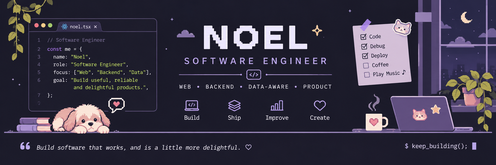

  

 

Software Engineer with a background in **Business Information Systems**.

I build web applications, APIs, and data-driven systems with a focus on turning real business requirements into reliable software.

 

<strong>TECH STACK</strong>

  
  
  
  
  
  
  
  
  
  

 

<strong>CURRENTLY EXPLORING</strong>

AI-assisted software development, automation, and modern SaaS architecture.

 

<strong>CONNECT</strong>

  
  
  

